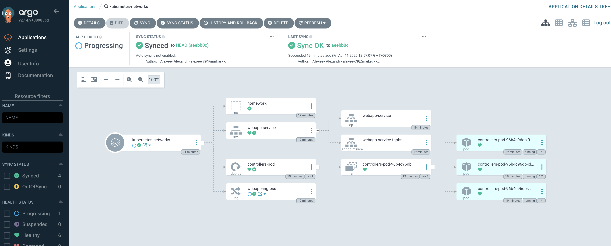
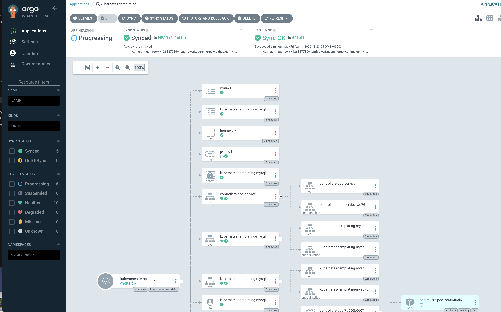

# Создаем ноды кластера
yc managed-kubernetes node-group create \
  --cluster-name $CLUSTER_NAME \
  --name apps-node-group \
  --platform standard-v2 \
  --cores 2 \
  --memory 4 \
  --disk-type network-hdd \
  --disk-size 50 \
  --fixed-size 1 \
  --node-labels node-role=apps \
  --location zone=ru-central1-d

done (1m21s)
id: cat8jed31lf32dahivlk
cluster_id: catjq79f5lpn1ddm9iti
created_at: "2025-04-08T13:35:05Z"
name: apps-node-group
status: RUNNING

yc managed-kubernetes node-group create \
  --cluster-name $CLUSTER_NAME \
  --name infra-node-group \
  --platform standard-v2 \
  --cores 2 \
  --memory 4 \
  --disk-type network-hdd \
  --disk-size 50 \
  --fixed-size 1 \
  --node-labels node-role=infra \
  --node-taints node-role=infra:NoSchedule \
  --location zone=ru-central1-d

done (1m23s)
id: catkpdrp17kdredisc7s
cluster_id: catjq79f5lpn1ddm9iti
created_at: "2025-04-08T13:37:31Z"
name: infra-node-group
status: RUNNING

# Добавим Helm-репозиторий ArgoCD

helm repo add argo https://argoproj.github.io/argo-helm
nfilippov@MacBook-Pro-Nikolay kubernetes-gitops % helm repo update
Hang tight while we grab the latest from your chart repositories...
...Successfully got an update from the "argo" chart repositor

# Создаём конфигурацию ArgoCD kubernetes-gitops/argocd/values.yaml
global:
  nodeSelector:
    node-role: infra
  tolerations:
    - key: "node-role"
      operator: "Equal"
      value: "infra"
      effect: "NoSchedule"

controller:
  nodeSelector:
    node-role: infra
  tolerations:
    - key: "node-role"
      operator: "Equal"
      value: "infra"
      effect: "NoSchedule"

server:
  nodeSelector:
    node-role: infra
  tolerations:
    - key: "node-role"
      operator: "Equal"
      value: "infra"
      effect: "NoSchedule"

repoServer:
  nodeSelector:
    node-role: infra
  tolerations:
    - key: "node-role"
      operator: "Equal"
      value: "infra"
      effect: "NoSchedule"

# Устанавливаем ArgoCD в кластер

nfilippov@MacBook-Pro-Nikolay kubernetes-gitops % helm upgrade --install argocd argo/argo-cd --namespace argocd --create-namespace -f argocd/values.yaml
Release "argocd" does not exist. Installing it now.
NAME: argocd
LAST DEPLOYED: Tue Apr  8 18:32:52 2025
NAMESPACE: argocd
STATUS: deployed
REVISION: 1
TEST SUITE: None
NOTES:
In order to access the server UI you have the following options:

1. kubectl port-forward service/argocd-server -n argocd 8080:443

    and then open the browser on http://localhost:8080 and accept the certificate

2. enable ingress in the values file `server.ingress.enabled` and either
      - Add the annotation for ssl passthrough: https://argo-cd.readthedocs.io/en/stable/operator-manual/ingress/#option-1-ssl-passthrough
      - Set the `configs.params."server.insecure"` in the values file and terminate SSL at your ingress: https://argo-cd.readthedocs.io/en/stable/operator-manual/ingress/#option-2-multiple-ingress-objects-and-hosts

After reaching the UI the first time you can login with username: admin and the random password generated during the installation. You can find the password by running:

kubectl -n argocd get secret argocd-initial-admin-secret -o jsonpath="{.data.password}" | base64 -d

(You should delete the initial secret afterwards as suggested by the Getting Started Guide: https://argo-cd.readthedocs.io/en/stable/getting_started/#4-login-using-the-cli)

nfilippov@MacBook-Pro-Nikolay kubernetes-gitops % kubectl get ns

NAME              STATUS   AGE
default           Active   130m
kube-node-lease   Active   130m
kube-public       Active   130m
kube-system       Active   130m
yandex-system     Active   129m
nfilippov@MacBook-Pro-Nikolay kubernetes-gitops % kubectl get all -n argocd      
NAME                                                    READY   STATUS      RESTARTS   AGE
pod/argocd-application-controller-0                     1/1     Running     0          51s
pod/argocd-applicationset-controller-5c8bd889dd-cqmvh   1/1     Running     0          51s
pod/argocd-dex-server-5c6f749498-tg2m5                  1/1     Running     0          51s
pod/argocd-notifications-controller-77f8fd66b9-mnxqh    1/1     Running     0          51s
pod/argocd-redis-774c4f74c5-kd4bj                       1/1     Running     0          51s
pod/argocd-redis-secret-init-fn8nt                      0/1     Completed   0          57s
pod/argocd-repo-server-59fbd4767-hbf4m                  1/1     Running     0          51s
pod/argocd-server-6558b76f76-m2zgr                      1/1     Running     0          51s

NAME                                       TYPE        CLUSTER-IP      EXTERNAL-IP   PORT(S)             AGE
service/argocd-applicationset-controller   ClusterIP   10.96.170.255   <none>        7000/TCP            52s
service/argocd-dex-server                  ClusterIP   10.96.212.116   <none>        5556/TCP,5557/TCP   52s
service/argocd-redis                       ClusterIP   10.96.207.110   <none>        6379/TCP            52s
service/argocd-repo-server                 ClusterIP   10.96.214.78    <none>        8081/TCP            52s
service/argocd-server                      ClusterIP   10.96.180.86    <none>        80/TCP,443/TCP      52s

NAME                                               READY   UP-TO-DATE   AVAILABLE   AGE
deployment.apps/argocd-applicationset-controller   1/1     1            1           51s
deployment.apps/argocd-dex-server                  1/1     1            1           51s
deployment.apps/argocd-notifications-controller    1/1     1            1           51s
deployment.apps/argocd-redis                       1/1     1            1           51s
deployment.apps/argocd-repo-server                 1/1     1            1           51s
deployment.apps/argocd-server                      1/1     1            1           51s

NAME                                                          DESIRED   CURRENT   READY   AGE
replicaset.apps/argocd-applicationset-controller-5c8bd889dd   1         1         1       51s
replicaset.apps/argocd-dex-server-5c6f749498                  1         1         1       51s
replicaset.apps/argocd-notifications-controller-77f8fd66b9    1         1         1       51s
replicaset.apps/argocd-redis-774c4f74c5                       1         1         1       51s
replicaset.apps/argocd-repo-server-59fbd4767                  1         1         1       51s
replicaset.apps/argocd-server-6558b76f76                      1         1         1       51s

NAME                                             READY   AGE
statefulset.apps/argocd-application-controller   1/1     51s

NAME                                 COMPLETIONS   DURATION   AGE
job.batch/argocd-redis-secret-init   1/1           3s         57s

# Создадим AppProject otus project-otus.yaml
apiVersion: argoproj.io/v1alpha1
kind: AppProject
metadata:
  name: otus
  namespace: argocd
spec:
  description: Otus GitOps project
  sourceRepos:
    - 'https://github.com/Kuber-2024-02OTUS/emepic_repo.git'
    - 'https://github.com/Kuber-2024-10OTUS/emepic_repo.git'
  destinations:
    - namespace: '*'
      server: 'https://kubernetes.default.svc'
  clusterResourceWhitelist:
    - group: '*'
      kind: '*'

nfilippov@MacBook-Pro-Nikolay kubernetes-gitops % kubectl apply -f project-otus.yaml 
appproject.argoproj.io/otus created

# Создадим приложение kubernetes-networks application-networks.yaml

apiVersion: argoproj.io/v1alpha1
kind: Application
metadata:
  name: kubernetes-networks
  namespace: argocd
spec:
  project: otus
  source:
    repoURL: 'https://github.com/Kuber-2024-02OTUS/emepic_repo.git'
    targetRevision: HEAD
    path: kubernetes-networks
  destination:
    server: 'https://kubernetes.default.svc'
    namespace: homework
  syncPolicy:
    syncOptions:
      - CreateNamespace=true

nfilippov@MacBook-Pro-Nikolay kubernetes-gitops % kubectl apply -f application-networks.yaml 
application.argoproj.io/kubernetes-networks created

nfilippov@MacBook-Pro-Nikolay ~ % kubectl label node cl1itp7t88at4iak7tl7-ofyd homework=true
node/cl1itp7t88at4iak7tl7-ofyd labeled

# Проверим что все запустилось

# Создадим приложение kubernetes-templating application-templating.yaml
apiVersion: argoproj.io/v1alpha1
kind: Application
metadata:
  name: kubernetes-templating
  namespace: argocd
spec:
  project: otus
  source:
    repoURL: 'https://github.com/Kuber-2024-10OTUS/emepic_repo.git'
    targetRevision: HEAD
    path: kubernetes-templating/otushw-6-chart
    helm:
      valueFiles:
        - values.yaml
      parameters:
        - name: replicaCount
          value: "3"
  destination:
    server: 'https://kubernetes.default.svc'
    namespace: homeworkhelm
  syncPolicy:
    automated:
      prune: true
      selfHeal: true
    syncOptions:
      - CreateNamespace=true

nfilippov@MacBook-Pro-Nikolay kubernetes-gitops % kubectl apply -f application-templating.yaml 
application.argoproj.io/kubernetes-templating created

# Убедимся что все запустилось

