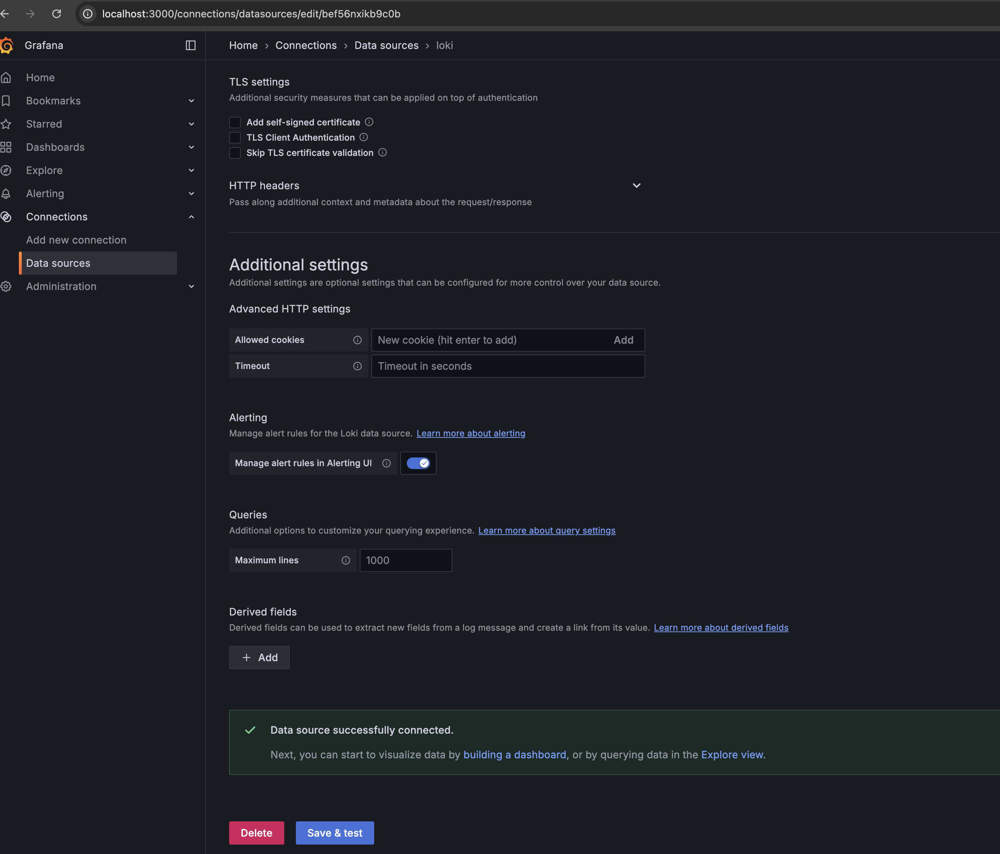
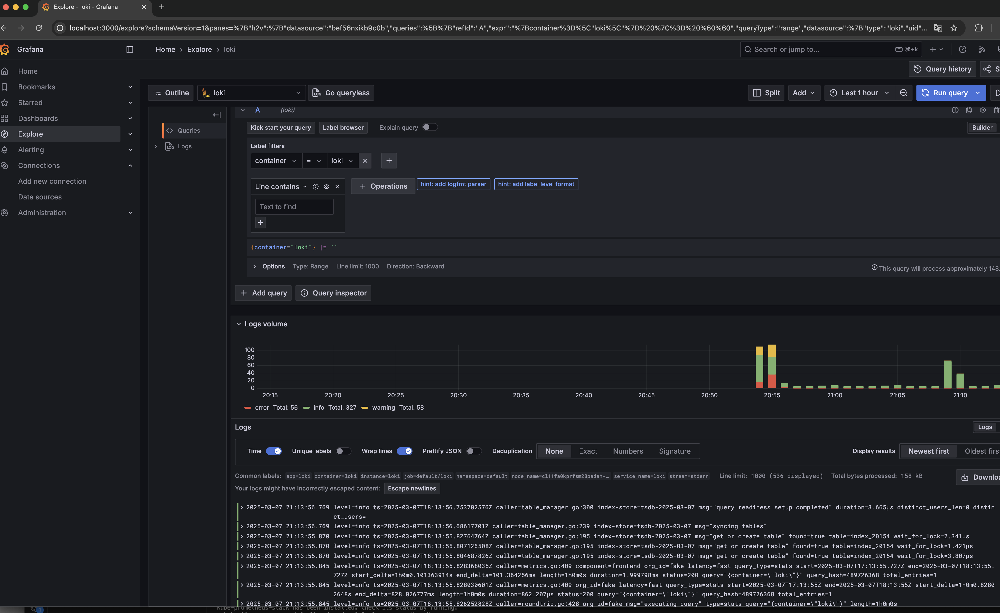

# Создадим два пула нод
nfilippov@MacBook-Pro-Nikolay kubernetes-logging % yc managed-kubernetes node-group create --name worker-nodes --cluster-name otushw9 --fixed-size 1
done (1m34s)
id: catocrg46sk7dd2enbmn
cluster_id: catup1np29nhq9on71v2

nfilippov@MacBook-Pro-Nikolay kubernetes-logging % yc managed-kubernetes node-group create --name infra-nodes --cluster-name otushw9 --fixed-size 1 --node-taints node-role=infra:NoSchedule
done (1m26s)
id: catghl6ut4i81ib9biqk
cluster_id: catup1np29nhq9on71v2

nfilippov@MacBook-Pro-Nikolay kubernetes-logging % kubectl get node -o wide --show-labels
NAME                        STATUS   ROLES    AGE   VERSION   INTERNAL-IP   EXTERNAL-IP       OS-IMAGE             KERNEL-VERSION      CONTAINER-RUNTIME     LABELS
cl11fa0kprfsm28padah-azoz   Ready    infra    84m   v1.29.1   10.130.0.38   158.160.139.227   Ubuntu 20.04.6 LTS   5.4.0-204-generic   containerd://1.6.28   beta.kubernetes.io/arch=amd64,beta.kubernetes.io/instance-type=standard-v3,beta.kubernetes.io/os=linux,failure-domain.beta.kubernetes.io/zone=ru-central1-d,kubernetes.io/arch=amd64,kubernetes.io/hostname=cl11fa0kprfsm28padah-azoz,kubernetes.io/os=linux,node-role.kubernetes.io/infra=,node-role=infra,node.kubernetes.io/instance-type=standard-v3,node.kubernetes.io/kube-proxy-ds-ready=true,node.kubernetes.io/masq-agent-ds-ready=true,node.kubernetes.io/node-problem-detector-ds-ready=true,topology.kubernetes.io/zone=ru-central1-d,yandex.cloud/node-group-id=catghl6ut4i81ib9biqk,yandex.cloud/pci-topology=k8s,yandex.cloud/preemptible=false
cl11qjo3b0hrhij4do45-ofes   Ready    <none>   28h   v1.29.1   10.130.0.36   158.160.156.82    Ubuntu 20.04.6 LTS   5.4.0-204-generic   containerd://1.6.28   beta.kubernetes.io/arch=amd64,beta.kubernetes.io/instance-type=standard-v2,beta.kubernetes.io/os=linux,failure-domain.beta.kubernetes.io/zone=ru-central1-d,kubernetes.io/arch=amd64,kubernetes.io/hostname=cl11qjo3b0hrhij4do45-ofes,kubernetes.io/os=linux,node.kubernetes.io/instance-type=standard-v2,node.kubernetes.io/kube-proxy-ds-ready=true,node.kubernetes.io/masq-agent-ds-ready=true,node.kubernetes.io/node-problem-detector-ds-ready=true,topology.kubernetes.io/zone=ru-central1-d,yandex.cloud/node-group-id=catocrg46sk7dd2enbmn,yandex.cloud/pci-topology=k8s,yandex.cloud/preemptible=false
nfilippov@MacBook-Pro-Nikolay kubernetes-logging % 

nfilippov@MacBook-Pro-Nikolay kubernetes-logging % kubectl get nodes -o custom-columns=NAME:.metadata.name,TAINTS:.spec.taints
NAME                        TAINTS
cl11fa0kprfsm28padah-azoz   [map[effect:NoSchedule key:node-role value:infra]]
cl11qjo3b0hrhij4do45-ofes   <none>

# Создадим бакет и ServiceAccount

nfilippov@MacBook-Pro-Nikolay kubernetes-logging % yc storage bucket create --name hw9-loki-bucket
name: hw9-loki-bucket
folder_id: b1gd9vjlmb00lgn32h1v

nfilippov@MacBook-Pro-Nikolay kubernetes-logging % yc iam service-account create --name loki-sa
done (1s)
id: aje2hok92ut1ha2i64ee

nfilippov@MacBook-Pro-Nikolay kubernetes-logging % yc resource-manager folder add-access-binding --id b1gd9vjlmb00lgn32h1v --role storage.editor --service-account-name loki-sa
done (2s)
effective_deltas:

nfilippov@MacBook-Pro-Nikolay kubernetes-logging % yc iam key create --service-account-name loki-sa --output key.json
id: aje44nki10558bdjqcv2

# Установим Loki при помощи Helm

nfilippov@MacBook-Pro-Nikolay kubernetes-logging % helm install loki grafana/loki --version 6.27.0 -f loki-values.yaml          
NAME: loki
NAMESPACE: default
STATUS: deployed
REVISION: 1
NOTES:
***********************************************************************
 Welcome to Grafana Loki
 Chart version: 6.27.0
 Chart Name: loki
 Loki version: 3.4.2
******************************************************************

# Установим Promtail при помощи helm

nfilippov@MacBook-Pro-Nikolay kubernetes-logging % helm install promtail grafana/promtail --version 6.16.6 -f promtail-values.yaml 
NAME: promtail
NAMESPACE: default
STATUS: deployed
REVISION: 1
TEST SUITE: None
NOTES:
***********************************************************************
 Welcome to Grafana Promtail
 Chart version: 6.16.6
 Promtail version: 3.0.0

# Установим Grafana при помощи helm

nfilippov@MacBook-Pro-Nikolay kubernetes-logging % helm install grafana grafana/grafana -f grafana-values.yaml
NAME: grafana
NAMESPACE: default
STATUS: deployed
REVISION: 1

# Сделаем port-forward grafana

nfilippov@MacBook-Pro-Nikolay kubernetes-logging % kubectl port-forward svc/grafana 3000:80

# Перейдем в веб интерфейс и подключим loki

# Проверим что данные поступают

