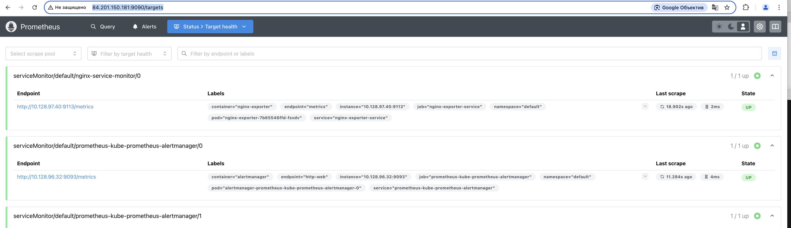

# Создадим файл Dockerfile в папке kubernetes-monitoring
FROM nginx:latest

## Установка необходимых инструментов
RUN apt-get update && apt-get install -y wget

## Скачивание и установка nginx-prometheus-exporter
RUN wget https://github.com/nginxinc/nginx-prometheus-exporter/releases/download/v0.10.0/nginx-prometheus-exporter_0.10.0_linux_amd64.tar.gz
RUN tar -xzf nginx-prometheus-exporter_0.10.0_linux_amd64.tar.gz
RUN mv nginx-prometheus-exporter /usr/local/bin/

## Копирование конфигурации Nginx
COPY nginx.conf /etc/nginx/nginx.conf

## Запуск Nginx и экспортера
CMD nginx -g "daemon off;" & nginx-prometheus-exporter -nginx.scrape-uri http://localhost/status

# Создадим файл nginx.conf в той же папке:
events {
    worker_connections 1024;
}

http {
    server {
        listen 80;

        location /status {
            stub_status on;
            allow all;
        }
    }
}

# Соберем и опубликуем образ:
nfilippov@MacBook-Pro-Nikolay kubernetes-monitoring % docker build --platform linux/amd64 -t emepic/utushw8-nginx:latest .
[+] Building 16.8s (12/12) FINISHED                                                                                                                                                                             docker:desktop-linux
 => [internal] load build definition from Dockerfile                                                                                                                                                                            0.0s
 => => transferring dockerfile: 737B                                                                                                                                                                                            0.0s
 => [internal] load metadata for docker.io/library/nginx:latest                                                                                                                                                                 2.0s
 => [auth] library/nginx:pull token for registry-1.docker.io                                                                                                                                                                    0.0s
 => [internal] load .dockerignore                                                                                                                                                                                               0.0s
 => => transferring context: 2B                                                                                                                                                                                                 0.0s
 => [1/6] FROM docker.io/library/nginx:latest@sha256:9d6b58feebd2dbd3c56ab5853333d627cc6e281011cfd6050fa4bcf2072c9496                                                                                                           6.8s
 => => resolve docker.io/library/nginx:latest@sha256:9d6b58feebd2dbd3c56ab5853333d627cc6e281011cfd6050fa4bcf2072c9496                                                                                                           0.0s
 => => sha256:103f50cb3e9f200431b555078cce5e8df3db6ddc2e54d714a10b994e430e98a3 1.40kB / 1.40kB                                                                                                                                  0.2s
 => => sha256:943ea0f0c2e42ccacc72ac65701347eadb2b0cb22828fac30f1400bba3d37088 1.21kB / 1.21kB                                                                                                                                  0.4s
 => => sha256:9dd21ad5a4a6a856d82bb6bb6147c30ad90a9768c3651c55775354e7649bc74d 406B / 406B                                                                                                                                      0.6s
 => => sha256:d014f92d532d416c7b9eadb244f14f73fdb3d2ead120264b749e342700824f3c 957B / 957B                                                                                                                                      0.6s
 => => sha256:513c3649bb1480ca9a04c73f320b6b5a909e24e4ac18ae72fd56b818241d6730 626B / 626B                                                                                                                                      0.3s
 => => sha256:bf9acace214a6c23630803d90911f1fd7d1ba06a3083f0a62fd036a6d1d8e274 43.95MB / 43.95MB                                                                                                                                2.9s
 => => sha256:7cf63256a31a4cc44f6defe8e1af95363aee5fa75f30a248d95cae684f87c53c 28.22MB / 28.22MB                                                                                                                                5.3s
 => => extracting sha256:7cf63256a31a4cc44f6defe8e1af95363aee5fa75f30a248d95cae684f87c53c                                                                                                                                       0.4s
 => => extracting sha256:bf9acace214a6c23630803d90911f1fd7d1ba06a3083f0a62fd036a6d1d8e274                                                                                                                                       0.5s
 => => extracting sha256:513c3649bb1480ca9a04c73f320b6b5a909e24e4ac18ae72fd56b818241d6730                                                                                                                                       0.0s
 => => extracting sha256:d014f92d532d416c7b9eadb244f14f73fdb3d2ead120264b749e342700824f3c                                                                                                                                       0.0s
 => => extracting sha256:9dd21ad5a4a6a856d82bb6bb6147c30ad90a9768c3651c55775354e7649bc74d                                                                                                                                       0.0s
 => => extracting sha256:943ea0f0c2e42ccacc72ac65701347eadb2b0cb22828fac30f1400bba3d37088                                                                                                                                       0.0s
 => => extracting sha256:103f50cb3e9f200431b555078cce5e8df3db6ddc2e54d714a10b994e430e98a3                                                                                                                                       0.0s
 => [internal] load build context                                                                                                                                                                                               0.0s
 => => transferring context: 32B                                                                                                                                                                                                0.0s
 => [2/6] RUN apt-get update && apt-get install -y wget                                                                                                                                                                         5.2s
 => [3/6] RUN wget https://github.com/nginxinc/nginx-prometheus-exporter/releases/download/v0.10.0/nginx-prometheus-exporter_0.10.0_linux_amd64.tar.gz                                                                          1.8s 
 => [4/6] RUN tar -xzf nginx-prometheus-exporter_0.10.0_linux_amd64.tar.gz                                                                                                                                                      0.2s 
 => [5/6] RUN mv nginx-prometheus-exporter /usr/local/bin/                                                                                                                                                                      0.2s 
 => [6/6] COPY nginx.conf /etc/nginx/nginx.conf                                                                                                                                                                                 0.0s 
 => exporting to image                                                                                                                                                                                                          0.5s 
 => => exporting layers                                                                                                                                                                                                         0.5s 
 => => exporting manifest sha256:6e385a53d0da0a32cf5ad437da4fa9ccdc0e2304c017e1a352fc6b4938c5973b                                                                                                                               0.0s 
 => => exporting config sha256:2406fd976d2c716cdf95af69b4c97785329fb4f76241dc63c7afc9923b4eaa56                                                                                                                                 0.0s
 => => exporting attestation manifest sha256:341716a894cf44a17d2ae845188c3d8afd1584ced56874002a4871a47e055589                                                                                                                   0.0s
 => => exporting manifest list sha256:0d1edb779d21d179ad686d4250690d594a2dbe40fb657817f26fdce9797b3a77                                                                                                                          0.0s
 => => naming to docker.io/emepic/utushw8-nginx:latest                                                                                                                                                                          0.0s

 1 warning found (use docker --debug to expand):
 - JSONArgsRecommended: JSON arguments recommended for CMD to prevent unintended behavior related to OS signals (line 15)

nfilippov@MacBook-Pro-Nikolay kubernetes-monitoring % docker push emepic/utushw8-nginx:latest
The push refers to repository [docker.io/emepic/utushw8-nginx]
513c3649bb14: Pushed 
95dd54d4eec2: Pushed 
5332c22940ae: Pushed 
9b05ca980521: Pushed 
0a130c455b95: Pushed 
bf9acace214a: Pushed 
d014f92d532d: Pushed 
103f50cb3e9f: Pushed 
b8378523090f: Pushed
d88b86a699b5: Pushed 
7cf63256a31a: Pushed 
9dd21ad5a4a6: Pushed 
943ea0f0c2e4: Pushed 
latest: digest: sha256:0d1edb779d21d179ad686d4250690d594a2dbe40fb657817f26fdce9797b3a77 size: 856

# Установим Prometheus Operator с помощью Helm
nfilippov@MacBook-Pro-Nikolay kubernetes-monitoring % helm repo add prometheus-community https://prometheus-community.github.io/helm-charts
"prometheus-community" has been added to your repositories
nfilippov@MacBook-Pro-Nikolay kubernetes-monitoring % helm repo update
Hang tight while we grab the latest from your chart repositories...
...Unable to get an update from the "bitnami" chart repository (https://charts.bitnami.com/bitnami):
        failed to fetch https://charts.bitnami.com/bitnami/index.yaml : 403 Forbidden
...Successfully got an update from the "prometheus-community" chart repository
Update Complete. ⎈Happy Helming!⎈
nfilippov@MacBook-Pro-Nikolay kubernetes-monitoring % helm install prometheus prometheus-community/kube-prometheus-stack -f values.yaml
NAME: prometheus
LAST DEPLOYED: Tue Mar  4 13:02:12 2025
NAMESPACE: default
STATUS: deployed
REVISION: 1
NOTES:
kube-prometheus-stack has been installed. Check its status by running:
  kubectl --namespace default get pods -l "release=prometheus"

Get Grafana 'admin' user password by running:

  kubectl --namespace default get secrets prometheus-grafana -o jsonpath="{.data.admin-password}" | base64 -d ; echo

Access Grafana local instance:

  export POD_NAME=$(kubectl --namespace default get pod -l "app.kubernetes.io/name=grafana,app.kubernetes.io/instance=prometheus" -oname)
  kubectl --namespace default port-forward $POD_NAME 3000

Visit https://github.com/prometheus-operator/kube-prometheus for instructions on how to create & configure Alertmanager and Prometheus instances using the Operator.

# Создадим манифест nginx-deployment.yaml

apiVersion: apps/v1
kind: Deployment
metadata:
  name: nginx-deployment
spec:
  replicas: 1
  selector:
    matchLabels:
      app: nginx
  template:
    metadata:
      labels:
        app: nginx
    spec:
      containers:
      - name: nginx
        image: docker.io/emepic/utushw8-nginx:latest
        ports:
        - containerPort: 80

# Создадим манифест nginx-service.yaml

apiVersion: v1
kind: Service
metadata:
  name: nginx-service
spec:
  type: LoadBalancer
  selector:
    app: nginx
  ports:
  - protocol: TCP
    port: 80
    targetPort: 80

# Применим манифесты
nfilippov@MacBook-Pro-Nikolay kubernetes-monitoring % kubectl apply -f nginx-deployment.yaml
deployment.apps/nginx-deployment created
nfilippov@MacBook-Pro-Nikolay kubernetes-monitoring % kubectl apply -f nginx-service.yaml
service/nginx-service created

# Создадим манифест nginx-exporter-deployment.yaml
apiVersion: apps/v1
kind: Deployment
metadata:
  name: nginx-exporter
spec:
  replicas: 1
  selector:
    matchLabels:
      app: nginx-exporter
  template:
    metadata:
      labels:
        app: nginx-exporter
    spec:
      containers:
      - name: nginx-exporter
        image: nginx/nginx-prometheus-exporter:latest
        args:
          - "-nginx.scrape-uri=http://nginx-service/status"
        ports:
        - containerPort: 9113

# Создадим манифест nginx-exporter-service.yaml
apiVersion: v1
kind: Service
metadata:
  name: nginx-exporter-service
  labels:
    app: nginx-exporter
spec:
  selector:
    app: nginx-exporter
  ports:
  - name: metrics
    protocol: TCP
    port: 9113
    targetPort: 9113
# Применим манифесты
nfilippov@MacBook-Pro-Nikolay kubernetes-monitoring % kubectl apply -f nginx-exporter-deployment.yaml
deployment.apps/nginx-exporter created
nfilippov@MacBook-Pro-Nikolay kubernetes-monitoring % kubectl apply -f nginx-exporter-service.yaml
service/nginx-exporter-service created

# Создадим манифест nginx-service-monitor.yaml
apiVersion: monitoring.coreos.com/v1
kind: ServiceMonitor
metadata:
  name: nginx-service-monitor
  namespace: default
  labels:
    release: prometheus
spec:
  selector:
    matchLabels:
      app: nginx-exporter
  endpoints:
  - port: metrics
    path: /metrics
# Применим манифест
nfilippov@MacBook-Pro-Nikolay kubernetes-monitoring % kubectl apply -f nginx-service-monitor.yaml
servicemonitor.monitoring.coreos.com/nginx-service-monitor created

# Убедимся что все поды и сервисы запущены

nfilippov@MacBook-Pro-Nikolay kubernetes-monitoring % kubectl get po                                 
NAME                                                     READY   STATUS    RESTARTS        AGE
alertmanager-prometheus-kube-prometheus-alertmanager-0   2/2     Running   0               6m42s
nginx-deployment-564b56d879-mlr92                        1/1     Running   1 (5m45s ago)   5m47s
nginx-exporter-7b65546ffd-fsvdv                          1/1     Running   0               3s
prometheus-grafana-647bc9c599-d55k9                      3/3     Running   0               6m44s
prometheus-kube-prometheus-operator-6d998cfb8b-x2ldd     1/1     Running   0               6m44s
prometheus-kube-state-metrics-86cd66b745-qdshx           1/1     Running   0               6m44s
prometheus-prometheus-kube-prometheus-prometheus-0       2/2     Running   0               6m42s
prometheus-prometheus-node-exporter-nlfnx                1/1     Running   0               6m44s
prometheus-prometheus-node-exporter-z4qrw                1/1     Running   0               6m44s

nfilippov@MacBook-Pro-Nikolay kubernetes-monitoring % kubectl get svc
NAME                                      TYPE           CLUSTER-IP       EXTERNAL-IP       PORT(S)                         AGE
alertmanager-operated                     ClusterIP      None             <none>            9093/TCP,9094/TCP,9094/UDP      7m38s
kubernetes                                ClusterIP      10.128.160.1     <none>            443/TCP                         9m19s
nginx-exporter-service                    ClusterIP      10.128.183.25    <none>            9113/TCP                        5m37s
nginx-service                             LoadBalancer   10.128.166.163   51.250.37.240     80:30563/TCP                    6m35s
prometheus-grafana                        LoadBalancer   10.128.186.105   158.160.138.138   80:31716/TCP                    7m40s
prometheus-kube-prometheus-alertmanager   ClusterIP      10.128.176.48    <none>            9093/TCP,8080/TCP               7m40s
prometheus-kube-prometheus-operator       ClusterIP      10.128.187.18    <none>            443/TCP                         7m40s
prometheus-kube-prometheus-prometheus     LoadBalancer   10.128.170.157   84.201.150.181    9090:31413/TCP,8080:32760/TCP   7m40s
prometheus-kube-state-metrics             ClusterIP      10.128.180.31    <none>            8080/TCP                        7m40s
prometheus-operated                       ClusterIP      None             <none>            9090/TCP                        7m38s
prometheus-prometheus-node-exporter       ClusterIP      10.128.169.73    <none>            9100/TCP                        7m40s

# Перейдем на страницу http://84.201.150.181:9090/targets и убедимся что данные от монитора поступают

